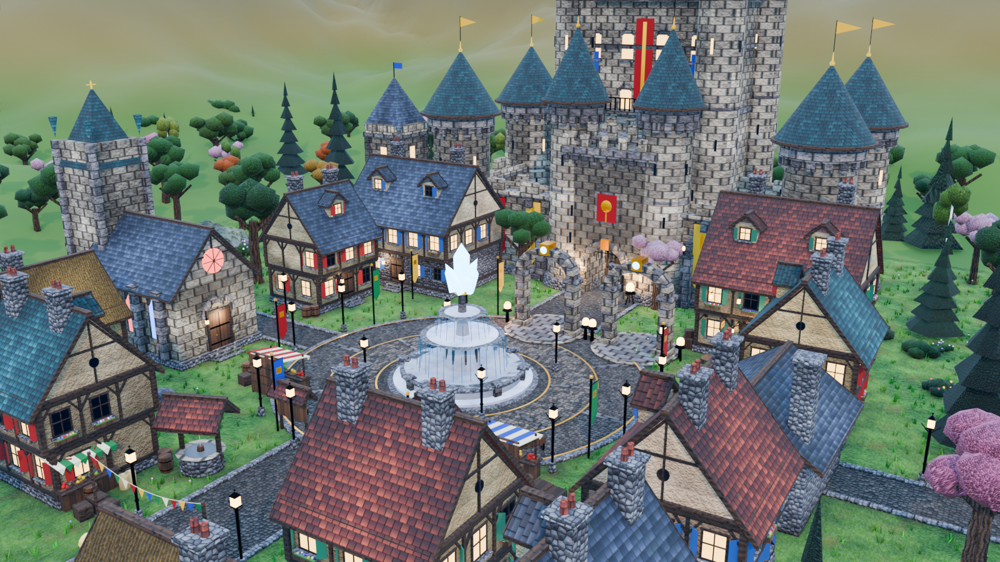

# Lobby world generator

Procedural Blender pipeline for the town hub (`apps/client/public/models/lobby_world.glb`).
Everything is code — change a number, re-run, re-export. No hand-edited meshes.



## Run it

Needs Blender 4.2+ (built on 5.3) with the MCP add-on, or just open Blender's Scripting tab.

```python
import bpy, bmesh, math, random
G = {"__name__": "lobby", "bpy": bpy, "bmesh": bmesh}
for f in ("common", "buildings", "world_a", "world_b", "world_c", "world_d", "world_e", "world_f"):
    exec(open(f"/…/tools/lobby/{f}.py").read(), G)
G["build_all"]()      # ~30 s: textures, terrain, town, castle, nature, grass  (also writes layout.json)
G["bake_ao"]()        # ~30 s: per-object vertex ambient occlusion
G["export_glb"]()     # merges tree instances into chunks, writes the .glb (meshopt-compressed)
```

Then, from the repo root:

```bash
python3 tools/lobby/gen_game_data.py      # collision circles -> packages/shared, lights/halos/smoke -> client
pnpm --filter @arena/shared build
```

`G["preview_rig"]()` + `G["aim"](cam, loc, target)` set up a dusk preview camera for EEVEE renders.

## Modules

| file | what |
| --- | --- |
| `textures.py` | tileable albedo + normal maps from shared height fields (masonry, plaster, timber, roof tiles, grass, marble, foliage…) |
| `common.py` | `B` primitive builder (transform stack, per-primitive vertex tint, world-scale box UVs), PBR materials |
| `buildings.py` | half-timber house generator (jetties, corbels, shutters, flower boxes, dormers, chimneys…) + props |
| `world_a.py` | layout registry, terrain, ground, plaza, roads, fountain, portal gates |
| `world_b.py` | tavern, guild hall, smithy, chapel + bell tower, houses, market stalls, street furniture |
| `world_c.py` | the castle (machicolated walls, gatehouse + portcullis, towers, keep, bailey) |
| `world_d.py` | tree / bush / rock prototypes, scatter, merged grass + flowers |
| `world_e.py` | orchestration + preview rig |
| `world_f.py` | AO bake + GLB export |
| `gen_game_data.py` | `layout.json` → shared collision + client `lobbyLayout.ts` |

## Coordinates

Authored at game scale (1 unit = 1 m). Blender `(X, Y, Z)` = game `(x, -z, up)`; glTF export maps that to
three `(x, up, z)` so the model drops into the game with no transform. The castle gate faces +z (toward town).

Fixed gameplay objects the layout leaves room for: spawn `(0,12)`, fountain `(0,-2)`, tablet `(7,-3)`,
podium `(11,-4)`, duel altar `(-7,-3)`, breach rift `(-11.5,-3.5)`, arena portal `(0,-14)`, zombie portal `(8,-14)`.

## Conventions

* Author colours perceptually; `lin()` converts for vertex/factor colours (Blender + glTF vertex colours are linear).
* Objects named `Castle_Front*` fade out in-game when the player is inside the bailey.
* `Col` (vertex colour) = tint × baked AO; the engine multiplies it into the albedo.
* The castle footprint must match `CASTLE` / `CASTLE_TOWERS` in `packages/shared/src/constants.ts`.
